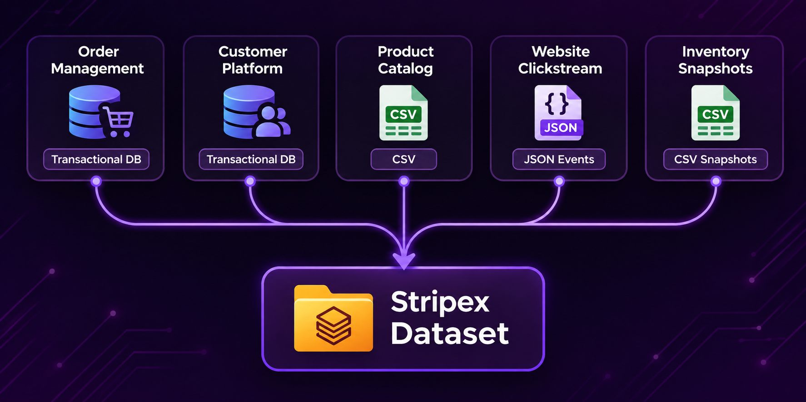
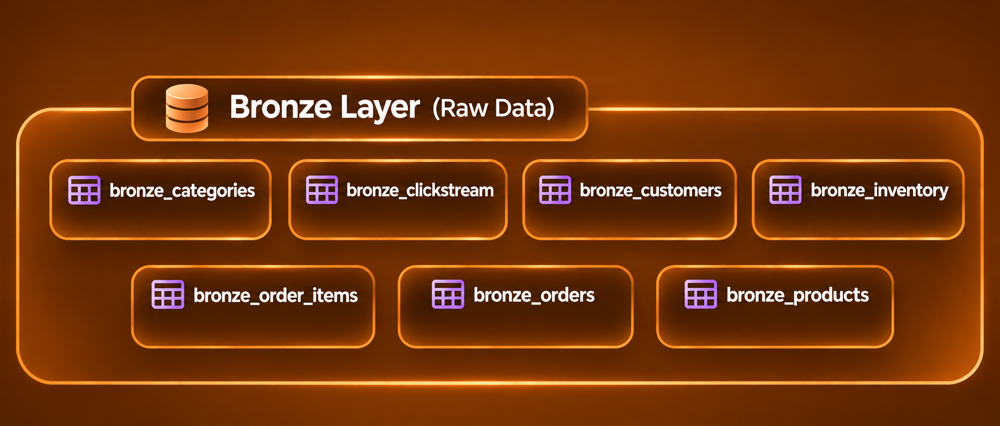
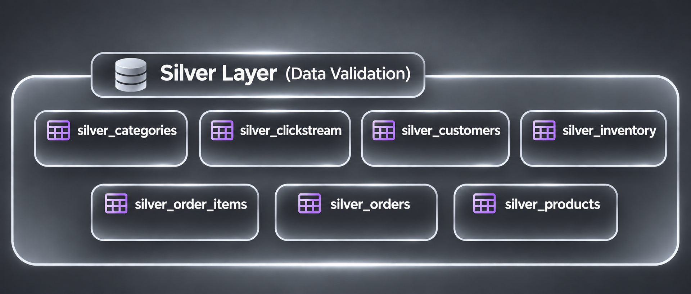
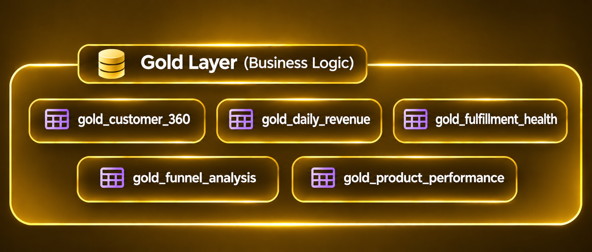
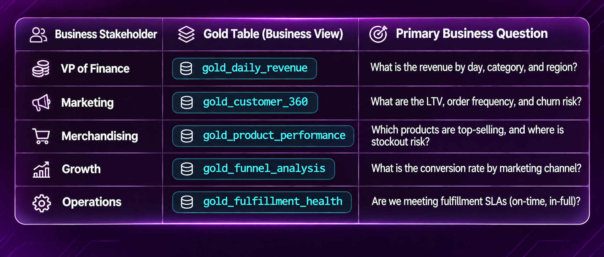
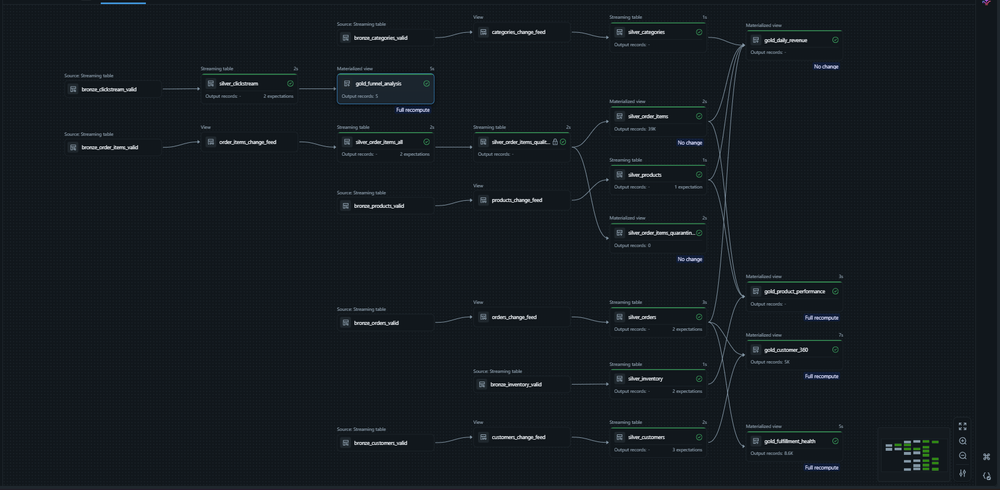

  
  &nbsp;&nbsp;&nbsp;&nbsp;
  <h1 align="center">StripeX Lakehouse End-to-End Medallion Pipeline</h1>

 

<h2 align="center">Project Background</h2>

<strong>StripeX</strong> is an online footwear retailer. The dataset we use in this project is synthetic data we will generate it by using Python Faker library. To understand our dataset better, we need to know from which sources we collect them. The data comes from 5 different source system:

  

<ul>
  <li><strong>Order management DB:</strong> transactional OLTP database. Tuned for fast small writes, can not be used for analytical workload</li>
  <li><strong>Customer platform:</strong> transactional OLTP database. Same as Order Management DB.</li>
  <li><strong>Product catalog:</strong> CSV export files. Data changes less frequently.</li>
  <li><strong>Website clickstream:</strong> raw JSON customer events on StripeX website.</li>
  <li><strong>Inventory:</strong> nightly inventory CSV snapshot files.</li>
  
</ul>
 
 
<h2 align="center">Problems we solve in this project:</h2>
 

<strong>1.Finance:</strong> in StripeX company the revenue is a hand-stitched spreadsheets, a day late and open to human error. The team needs to export data from 3 different sources and compile it together manually and make it ready to the VP of Finance every morning.

 

<strong>2.Marketing:</strong> in company nobody can answer to "which customer about to churn? Or From which marketing channel did customer heard about the company?". This questions can't be answered without pulling 3 people into the room and a half day of exporting and cross-referencing multiple Excel sheets.

 

<strong>3.Merchandising:</strong> reordering the stock is often based on a gut feel and a monthly Excel report. These reports are already stale by the time anyone reads it and you can't always trust them. Popular shoe brands and sizes getting out of stock, unpopular brands are lying in the dead stock.

 

  

 
 
<h2 align="center">Medallion Architecture.</h2>
 

<strong>Bronze layer:</strong> keeps the data as it arrives, never modifies raw data that landed in this layer.

  

 

<strong>Silver layer:</strong> uses the files arrived into Bronze layer, filters and validates. Gold layer materialized views uses data from this layer, so it is important the data to be valid/correct.

  

 

<strong>Gold layer:</strong> business questions are answered in this layer by applying join and aggregations in materialized views.

  

 

Each materialized view in our gold layer answers the business question of different stakeholders.

  

 
<h2 align="center">Testing, Monitoring and CI/CD Pipelines.</h2>
 

In this Lakehouse project we used Medallion Architecture, Unity Catalog, Delta Lake. Also we'll be doing Unit Testing, Integration testing, DABs for bundling the project deploying it into the UI environment using a complete E2E CI/CD pipeline.

<h4>Testing:</h4>

To ensure the reliability, accuracy, and consistency of the StripeX Lakehouse, we implement a comprehensive testing strategy covering <strong>unit tests, integration tests, and automated data quality checks.</strong> Unit tests validate individual transformation logic and business rules to ensure each component behaves as expected. Integration tests verify that different components of the pipeline work together correctly, including data ingestion, transformations, and orchestration across the Bronze, Silver, and Gold layers.

<h4>Monitoring:</h4>

To maintain visibility into the health, reliability, and overall quality of the StripeX Lakehouse, we implement a centralized monitoring solution using Databricks Dashboards. Monitoring focuses on key areas such as referential integrity violations, data quality expectation failures, and quarantine tables that capture invalid or rejected records during processing.

<h4>CI/CD and Deployment:</h4>

To ensure consistent, reliable, and repeatable deployments, we use Databricks Asset Bundles (DAB) to package and manage the StripeX Lakehouse project as a deployable unit. Combined with a CI/CD pipeline, this approach automates the validation, testing, and deployment processes, reducing the need for manual intervention and minimizing deployment-related errors.

 

  

 

<strong>For step-by-step instructions on building this project, refer to the screenshots subfolder within each module's directory.</strong>

